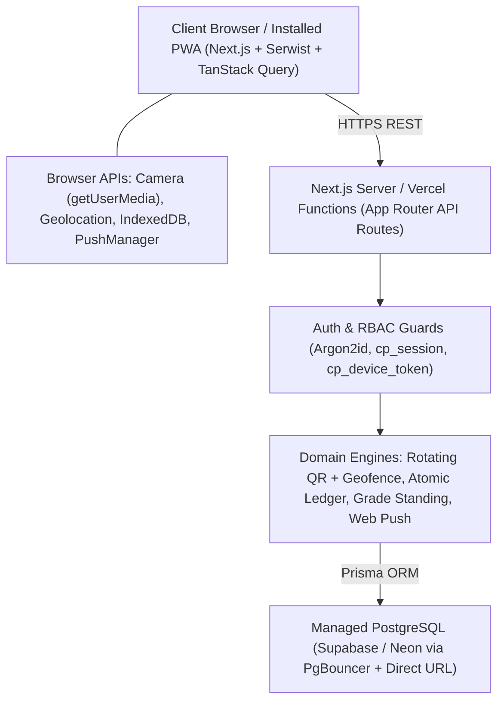

# Puento — Classroom Companion

> **Location-verified QR attendance, gamified per-subject point economy, and transparent class standing — built as a mobile-first Progressive Web App (PWA).**

*(Repository package: `pointing-system`; internal/seed references also use `ClassPulse` in companion documentation.)*

---

## Table of Contents

- [Overview & Core Principles](#overview--core-principles)
- [Features by Role](#features-by-role)
- [Tech Stack](#tech-stack)
- [System Architecture](#system-architecture)
- [Security & Anti-Cheat Model](#security--anti-cheat-model)
- [Project Structure](#project-structure)
- [Environment Variables](#environment-variables)
- [Local Development Setup](#local-development-setup)
- [PWA & Web Push Setup](#pwa--web-push-setup)
- [Production Deployment (Vercel + Supabase / Neon)](#production-deployment-vercel--supabase--neon)
- [Testing & CI Verification](#testing--ci-verification)
- [API Route Overview](#api-route-overview)
- [Available Scripts](#available-scripts)
- [Troubleshooting & FAQ](#troubleshooting--faq)
- [Companion Documentation](#companion-documentation)
- [Contributing & License](#contributing--license)

---

## Overview & Core Principles

**Puento** modernizes classroom attendance, behavioral incentives, and grade transparency in a unified full-stack Next.js App Router application backed by PostgreSQL and Prisma.

Key design principles:

- **Per-Subject Point Isolation:** Every subject maintains its own isolated point wallet (`availableBalance` and `escrowedBalance`), reward catalog, P2P transfer limits, grade computation rules, and grading scale. Points earned in one subject cannot be spent or transferred in another.
- **Fraud-Resistant Attendance:** Combines short-lived HMAC-signed rotating QR codes, teacher-anchored Haversine GPS geofencing, and browser/device deduplication to block remote check-ins and proxy attendance.
- **Atomic Financial-Style Point Ledger:** All point mutations (attendance awards, teacher merits/demerits, P2P transfers, reward redemptions, and score boost conversions) execute inside database transactions and append immutable `PointLedgerEntry` records.
- **Zero Student File Submissions:** Assessments are teacher-scored records with optional point-powered Score Boosts—students cannot upload files or turn in assignments through the app.
- **Privacy-First Geolocation:** GPS coordinates are read only on demand when a teacher opens/refreshes an attendance session or when a student submits an attendance QR scan. No background tracking occurs.

---

## Features by Role

### Student
- Register and log in via email or institutional ID (`student_number`) with password reset support.
- Join subjects via invite code or QR link (`/join`).
- Check in to open attendance sessions by scanning the teacher's rotating QR code with camera + GPS verification (`/subjects/[id]/check-in`).
- View per-subject wallet breakdown (Available vs. Escrowed points) and full immutable point ledger.
- Generate and scan subject-scoped GCash-style P2P QR codes to send or receive points with classmates (`/subjects/[id]/p2p`).
- Browse subject reward catalogs and request **Score Boosts** (applied to specific assessments) or **Fixed Perks**.
- View assessment scores, applied bonus points, live class standing percentages, and grade equivalents (default Philippine `1.00`–`5.00` scale, customizable per subject) when visibility is enabled.
- Receive in-app alerts and optional Web Push notifications.

### Teacher
- Create, configure, duplicate, archive, or delete subjects per active academic term; manage student rosters and bulk-unenroll students.
- Start, refresh GPS anchor, monitor live check-ins, manually override statuses (`PRESENT`, `LATE`, `EXCUSED`, `ABSENT`), and close geofenced attendance sessions (`/subjects/[id]/attendance`).
- Create reusable Merit/Demerit presets and award or deduct points individually or in bulk.
- Configure P2P transfer toggles and anti-farming caps (per-transfer, daily, and term limits), manage reward items, and approve/reject student redemption requests (automatically crediting assessment bonus points for approved Score Boosts).
- Define grade categories (`ASSESSMENT`, `ATTENDANCE`, `POINTS_PARTICIPATION`), weights, aggregation methods (`TOTAL_POINTS` / `EQUAL_AVERAGE`), custom grade scales, `INC`/`DRP` standing overrides, and export grade sheets to Excel (`.xlsx`) via `exceljs` (`/subjects/[id]/assessments`).

### Admin (`/admin`)
- Manage and verify teacher accounts (`ACTIVE`, `PENDING`, `SUSPENDED`) and issue quota-limited `TeacherInviteCode` values.
- Manage student accounts (including bulk cleanup) and active `AcademicTerm` schedules.
- Inspect institutional `AuditLog` entries, including anti-proxy device conflict flags and sensitive mutations.

---

## Tech Stack

| Layer | Technology | Purpose |
|---|---|---|
| **Framework** | Next.js `15.5` (App Router), React `19`, TypeScript `5.8` | Full-stack UI, Route Handlers, Server Components |
| **Styling & Icons** | Tailwind CSS `3.4`, `lucide-react`, `clsx`, `tailwind-merge` | Mobile-first responsive UI |
| **Client Data** | `@tanstack/react-query` `v5` | Caching and short-interval live polling on attendance/dashboards |
| **Database & ORM** | PostgreSQL + Prisma `6.6` | ACID transactions, relational integrity, schema management |
| **Validation** | Zod `3.24` | Runtime request, form, and environment validation |
| **Authentication** | `@node-rs/argon2` + HMAC-signed HTTP-only cookies | Password hashing (`argon2id`) and stateless-verifiable sessions with DB `sessionVersion` checks |
| **QR & Exports** | `qrcode`, `qrcode.react`, `html5-qrcode`, `exceljs` | Dynamic QR rendering, camera scanning, `.xlsx` grade sheet export |
| **PWA & Push** | `@serwist/next` `9.5`, `web-push` `4.0` | Service Worker asset caching and VAPID Web Push notifications |
| **Testing** | Vitest `3.1`, Playwright `1.52` | Unit tests, PostgreSQL integration tests, desktop & mobile E2E |

---

## System Architecture



### Core Data Models (`prisma/schema.prisma`)

- **Identity & Oversight:** `User`, `PasswordResetToken`, `TeacherInviteCode`, `AcademicTerm`, `AuditLog`
- **Classrooms & Attendance:** `Subject`, `SubjectEnrollment`, `AttendanceSession`, `AttendanceRecord`
- **Point Economy:** `PointLedgerEntry`, `MeritPreset`, `RewardItem`, `RedemptionRequest`
- **Grading & Notifications:** `GradeCategory`, `Assessment`, `AssessmentScore`, `GradeScaleRule`, `PushSubscription`, `Notification`

---

## Security & Anti-Cheat Model

1. **Authentication & Session Revocation (`src/lib/auth/`)**
   - Passwords are hashed with `@node-rs/argon2`.
   - Sessions use an HTTP-only, `SameSite=Lax` (and `Secure` in production) cookie (`cp_session`) with a 7-day TTL (`604800` seconds) signed with `AUTH_SECRET`.
   - `getCurrentUser()` validates both `status === "ACTIVE"` and `sessionVersion`, enabling immediate session invalidation on password resets or admin actions.
   - Public registration creates `STUDENT` accounts by default; `TEACHER` registration requires a valid `TeacherInviteCode`.

2. **Rotating Attendance QR (`src/lib/attendance/qr-token.ts`)**
   - Each session generates a 32-byte server-only `qrSecret`.
   - Tokens follow `att:<sessionId>:<bucket>:<hmac16>` where `bucket = Math.floor(nowMs / (rotationSeconds * 1000))`.
   - Verification uses constant-time comparison (`timingSafeEqual`) and accepts the current bucket or immediate previous bucket (`currentBucket - 1`) as a 1-tick grace window against scan lag.

3. **Haversine GPS Geofencing (`src/lib/attendance/geofence.ts`)**
   - Student GPS accuracy must be `<= 100m` (`MAX_STUDENT_GPS_ACCURACY_METERS`), otherwise check-in returns `ERR_LOW_GPS_ACCURACY`.
   - Great-circle distance is calculated via the Haversine formula (`R = 6,371,000m`).
   - Effective radius grants a capped accuracy buffer: `radiusMeters + min(studentAccuracyM, 25)` (`ACCURACY_BUFFER_CAP_METERS = 25`). Exceeding this returns `ERR_OUT_OF_RANGE`.

4. **Anti-Proxy Device Binding (`src/lib/device/token.ts`)**
   - Clients receive an HMAC-signed `cp_device_token` HTTP-only cookie (`DEVICE_PEPPER`, 1-year maxAge) mirrored via IndexedDB (`DeviceSync` provider).
   - Check-in hashes `SHA256("<deviceId>:<DEVICE_PEPPER>")` and enforces one QR check-in per physical device per attendance session, logging `ERR_PROXY_DEVICE_CONFLICT` anomalies to `AuditLog`.

5. **P2P QR Signing & Anti-Farming (`src/lib/points/p2p-qr.ts`, `src/lib/points/p2p-limits.ts`)**
   - P2P QR payloads (`p2p:<subjectId>:<receiverEnrollmentId>:<amount>:<noteB64>:<hmac16>`) are signed with `P2P_QR_SECRET` and scoped to a single subject.
   - Subject-level controls enforce `allowP2pTransfers`, positive whole-integer amounts, positive spendable balance checks, and configurable `p2pMaxPerTransfer`, `p2pMaxPerDay`, and `p2pMaxPerTerm` caps for both sender and receiver.

---

## Project Structure

```text
.
├── .github/workflows/ci.yml      # CI pipeline (generate, lint, typecheck, unit tests, build)
├── docs/                         # PRD, TRD, implementation plan, and launch checklist
├── e2e/                          # Playwright desktop & mobile E2E test suites
├── prisma/
│   ├── schema.prisma             # PostgreSQL schema (19 models)
│   └── seed.ts                   # Development baseline seed script
├── public/                       # Static icons and built service worker output (sw.js)
├── src/
│   ├── app/                      # Next.js App Router pages, manifest, sw.ts, and /api routes
│   ├── components/               # UI components and providers (QueryProvider, DeviceSync)
│   └── lib/
│       ├── admin/                # Admin deletion & oversight helpers
│       ├── attendance/           # Rotating QR tokens, Haversine geofencing, session DTOs
│       ├── auth/                 # Password hashing, session cookies, RBAC guards
│       ├── device/               # Signed device cookies & IndexedDB sync
│       ├── grading/              # Class standing engine, PH 1.00-5.00 scale, Excel export
│       ├── notifications/        # In-app + Web Push dispatchers
│       ├── points/               # Merit math, P2P QR signing, P2P limits, score boost hook
│       ├── subjects/             # Subject duplication, deletion, unenrollment services
│       ├── validations/          # Zod schemas
│       ├── audit.ts              # AuditLog writer
│       ├── db.ts                 # Prisma singleton with automatic PgBouncer query param guard
│       └── env.ts                # Zod environment variable validation
├── .env.example                  # Environment variable template
├── next.config.ts                # Next.js + Serwist PWA configuration
├── playwright.config.ts          # Playwright configuration (port 3100, Desktop + Pixel 7)
├── vitest.config.ts              # Unit test runner config
└── vitest.db.config.ts           # PostgreSQL integration test runner config
```

---

## Environment Variables

All server environment variables are validated at runtime in `src/lib/env.ts`:

| Variable | Required | Description |
|---|---|---|
| `DATABASE_URL` | **Yes** | PostgreSQL runtime connection string. For Supabase transaction pooling (port `6543`), include `?pgbouncer=true` (`src/lib/db.ts` also auto-appends `pgbouncer=true` for port `6543` if omitted). |
| `DIRECT_URL` | Recommended | Direct/session PostgreSQL URI (port `5432`) used by Prisma CLI (`prisma db push` / migrations). |
| `AUTH_SECRET` | **Yes** | Secret key (`>= 32` chars) for signing `cp_session` cookies. Generate with `openssl rand -hex 32`. |
| `DEVICE_PEPPER` | **Yes** | Secret key (`>= 32` chars) for signing `cp_device_token` cookies and hashing device fingerprints. Generate with `openssl rand -hex 32`. |
| `P2P_QR_SECRET` | **Yes** | Secret key (`>= 32` chars) for HMAC-signing subject P2P QR payloads. Generate with `openssl rand -hex 32`. |
| `NEXT_PUBLIC_VAPID_PUBLIC_KEY` | Optional | Public VAPID key for browser Web Push subscriptions (leave empty to run without push). |
| `VAPID_PRIVATE_KEY` | Optional | Server-only VAPID private key from `npm run push:vapid`. |
| `VAPID_SUBJECT` | Optional | VAPID contact URI, e.g. `mailto:admin@example.com`. |

---

## Local Development Setup

### Prerequisites

- **Node.js 20+** and **npm** (matches `.github/workflows/ci.yml`)
- **PostgreSQL** database (local PostgreSQL, Docker, Supabase, or Neon)

### 1. Clone and Install Dependencies

```bash
git clone https://github.com/Diel09/class_pointing_system.git
cd class_pointing_system
npm install
```

### 2. Configure `.env`

Copy `.env.example` to `.env` and fill in your PostgreSQL connection strings and 32+ character secrets:

```bash
cp .env.example .env
```

*(On Windows PowerShell, use `Copy-Item .env.example .env`.)*

To enable Web Push locally, generate VAPID keys and copy them into `.env`:

```bash
npm run push:vapid
```

### 3. Generate Prisma Client, Sync Schema & Seed Development Data

```bash
npx prisma generate
npm run db:push
```
### 4. Start the Development Server

```bash
npm run dev
```

Open `http://localhost:3000`. Verify database connectivity anytime via `GET /api/health`.

---

## PWA & Web Push Setup

- **Service Worker (`src/app/sw.ts` + `next.config.ts`):** `@serwist/next` compiles `src/app/sw.ts` into `public/sw.js` during `npm run build` and is intentionally disabled in `development` mode (`disable: process.env.NODE_ENV === "development"`).
- **Caching Strategy:** Caches static assets (`/_next/static/*.js`, fonts, images, CSS) while passing authenticated App Router navigations and `/api/*` requests directly to the network.
- **HTTPS Requirement:** Mobile and desktop browsers require a secure context (`https://`, or `http://localhost` during local dev) for:
  - Camera access (`getUserMedia` for QR scanning)
  - Geolocation (`navigator.geolocation` for attendance anchors & check-in)
  - Service Worker registration & Web Push notifications
- **Installing on Mobile:**
  - **Android (Chrome):** Open the HTTPS production URL -> tap **Install App** (or Chrome menu -> *Install app*).
  - **iOS (Safari 16.4+):** Open the HTTPS production URL -> tap **Share** -> **Add to Home Screen** -> launch from the Home Screen icon before enabling Push notifications.

---

## Production Deployment (Vercel + Supabase / Neon)

For the full operational launch runbook, see [docs/LAUNCH_CHECKLIST.md](./docs/LAUNCH_CHECKLIST.md).

### 1. Provision Managed PostgreSQL (Supabase or Neon)

- **Supabase:** Copy both:
  - **Transaction Pooler URI** (port `6543`, with `?pgbouncer=true`) -> `DATABASE_URL`
  - **Direct / Session URI** (port `5432`) -> `DIRECT_URL`
- **Neon:** Copy the pooled connection string (`-pooler` host) -> `DATABASE_URL`, and the direct connection string -> `DIRECT_URL`.
- Enable **Daily Backups / Point-in-Time Recovery (PITR)** in your database provider dashboard.

### 2. Generate Production Secrets & VAPID Keys

Generate unique cryptographic secrets (`>= 32` characters) and a fresh VAPID keypair:

```bash
# Secrets (run 3 separate times for AUTH_SECRET, DEVICE_PEPPER, P2P_QR_SECRET)
openssl rand -hex 32

# Web Push VAPID keys
npm run push:vapid
```

### 3. Deploy to Vercel

1. Import the repository into **Vercel**.
2. In **Project Settings -> Environment Variables**, add:
   - `DATABASE_URL`
   - `DIRECT_URL`
   - `AUTH_SECRET`
   - `DEVICE_PEPPER`
   - `P2P_QR_SECRET`
   - `NEXT_PUBLIC_VAPID_PUBLIC_KEY`
   - `VAPID_PRIVATE_KEY`
   - `VAPID_SUBJECT` (e.g., `mailto:support@yourdomain.edu`)
3. Build & deployment settings:
   - Framework Preset: **Next.js**
   - Node.js Version: **20.x**
   - Build Command: `npx prisma generate && npm run build` (recommended so Prisma Client is always generated cleanly)
4. Trigger a Production deployment (`vercel --prod` or push to `main`).

### 4. Push Schema & Verify Health

Run schema sync locally against your production `DIRECT_URL` (ensuring `DATABASE_URL` and `DIRECT_URL` in your shell point to production):

```bash
npx prisma db push
```

Verify the live deployment health endpoint:

```bash
curl https://your-domain.vercel.app/api/health
# Expected 200 OK: {"status":"ok","db":"connected","timestamp":"..."}
```

### 5. Bootstrap Your Production `ADMIN` Account (Without Dev Seed Data)

Because `npm run db:seed` inserts dummy students and `Password123!`, bootstrap your initial production `ADMIN` directly using a one-off `tsx` command against your production `.env`:

```bash
npx tsx --env-file=.env -e '
import { PrismaClient } from "@prisma/client";
import { hashPassword } from "./src/lib/auth/password";

const prisma = new PrismaClient();
async function run() {
  const passwordHash = await hashPassword("REPLACE_WITH_STRONG_PASSWORD");
  await prisma.user.create({
    data: {
      email: "admin@yourdomain.edu",
      institutionalId: "ADM-0001",
      fullName: "System Administrator",
      passwordHash,
      role: "ADMIN",
      status: "ACTIVE",
    },
  });
  console.log("Production admin created.");
}
run().finally(() => prisma.$disconnect());
'
```

Then sign in at `https://your-domain.vercel.app/login` and navigate to `/admin` to:
1. Create and activate your current **Academic Term** (e.g., `1st Sem 2026-2027`).
2. Generate **Teacher Invite Codes** for faculty onboarding.

### 6. Monitoring & Physical Device Smoke Test

- **Sentry (Recommended):** Connect the Sentry Vercel integration or run `npx @sentry/wizard@latest -i nextjs`, and alert on `500` responses for `/api/attendance/check-in`, `/api/subjects/*/transfers`, and `/api/redemptions/*/review`.
- **Device Smoke Test:** Test PWA installation, Web Push, 50m classroom QR attendance, out-of-range/expired QR rejection, `ERR_PROXY_DEVICE_CONFLICT`, P2P QR transfer, and Score Boost redemption on physical Android and iOS devices over HTTPS.

---

## Testing & CI Verification

### Unit Tests (Vitest)

Runs all `src/**/*.test.ts` and `src/**/*.test.tsx` tests (excluding `*.db.test.ts` and `e2e/`):

```bash
npm test
```

### Database Integration Tests (Vitest + PostgreSQL)

Runs `src/**/*.db.test.ts` (concurrency locks, boost standing, admin delete, roster unenroll, subject delete/duplicate) against the database configured in `.env`:

```bash
npm run test:db
```

### End-to-End Tests (Playwright)

`playwright.config.ts` runs against a production build served on `http://127.0.0.1:3100` (`npx next start -p 3100`) across both **Desktop Chrome** (`1280x800`) and **Mobile Chrome / Pixel 7** (`390x844`):

```bash
npx playwright install   # first time only
npm run build
npm run test:e2e
```

### GitHub Actions CI (`.github/workflows/ci.yml`)

Every push to `main`/`master` and every pull request automatically runs:
1. `npm ci`
2. `npx prisma generate`
3. `npm run lint`
4. `npm run typecheck`
5. `npm test`
6. `npm run build`

---

## API Route Overview

| Domain | Base Endpoints | Purpose |
|---|---|---|
| **Health** | `GET /api/health` | Runtime & PostgreSQL connectivity probe (`SELECT 1`) |
| **Auth** | `/api/auth/{login,logout,register,me}`, `/api/auth/password-reset/{request,confirm}` | Credentials auth, session lookup, registration, password reset |
| **Device** | `POST /api/device/register` | Issues/syncs signed `cp_device_token` cookie & IndexedDB mirror |
| **Admin** | `/api/admin/{teachers,students,terms,invites,audit-logs}` | Teacher verification, student management, terms, invite codes, audit logs |
| **Subjects** | `/api/subjects`, `/api/subjects/join`, `/api/subjects/[id]/{duplicate,roster}` | Subject CRUD, invite joining, duplication, enrollment & bulk unenroll |
| **Attendance** | `/api/subjects/[id]/sessions`, `/api/sessions/[id]/{live,location,override,close}`, `POST /api/attendance/check-in` | Rotating QR sessions, live rosters, GPS refresh, manual overrides, student check-in |
| **Points & Economy** | `/api/subjects/[id]/{wallet,ledger,presets,merits,p2p-qr,transfers,rewards,redemptions}`, `/api/redemptions/[id]/review` | Wallets, immutable ledger, merits/demerits, P2P QR transfers, reward catalog & reviews |
| **Grading** | `/api/subjects/[id]/{computation,grade-scale,assessments,standing,grade-sheet}`, `/api/assessments/[id]/scores` | Grade categories, scales, assessment scoring, class standing, `.xlsx` export |
| **Notifications** | `/api/notifications`, `/api/notifications/read`, `/api/push/subscribe` | In-app notification inbox & Web Push VAPID subscriptions |

---

## Available Scripts

| Command | Description |
|---|---|
| `npm run dev` | Start Next.js development server |
| `npm run build` | Build production app and compile Serwist Service Worker (`public/sw.js`) |
| `npm run start` | Start production Next.js server |
| `npm run lint` | Run ESLint (`next lint`) |
| `npm run typecheck` | Run TypeScript type checking (`tsc --noEmit`) |
| `npm test` | Run Vitest unit tests |
| `npm run test:db` | Run Vitest PostgreSQL integration tests (reads `.env`) |
| `npm run test:watch` | Run Vitest in watch mode |
| `npm run test:e2e` | Run Playwright desktop & mobile E2E test suite |
| `npm run db:generate` | Generate Prisma Client |
| `npm run db:push` | Push `prisma/schema.prisma` to PostgreSQL |
| `npm run db:seed` | Seed development admin, teachers, students, and sample subjects |
| `npm run push:vapid` | Generate a Web Push VAPID public/private keypair |

---

## Troubleshooting & FAQ

- **Prisma `42P05` prepared statement error on Supabase:** Ensure `DATABASE_URL` uses port `6543` with `?pgbouncer=true` and `DIRECT_URL` uses port `5432` for Prisma CLI commands (`db push` / migrations).
- **Camera or GPS prompt does not appear on mobile:** Browsers block `getUserMedia` and `navigator.geolocation` on non-HTTPS origins (other than `localhost`). Always test mobile devices against an `https://` URL (e.g., Vercel preview/production or an HTTPS tunnel).
- **Service Worker (`sw.js`) is not registering in dev:** This is intentional (`disable: process.env.NODE_ENV === "development"` in `next.config.ts`). Run `npm run build && npm run start` to test PWA offline caching and Web Push locally.
- **`ERR_LOW_GPS_ACCURACY` or `ERR_OUT_OF_RANGE` indoors:** Student device GPS accuracy exceeded `100m` or distance exceeded `radius + min(accuracy, 25m)`. Have the student move closer to a window/refresh GPS, ask the teacher to refresh the session GPS anchor, or use the teacher's manual attendance override.
- **`ERR_PROXY_DEVICE_CONFLICT`:** A second student account tried to check in using the same browser/device during the same session. Check `/admin` Audit Logs or have the teacher verify and manually override if a device was legitimately shared.
- **iOS Web Push not prompting:** On iOS 16.4+, Web Push only works after the user installs the app via **Share -> Add to Home Screen** and opens Puento from the Home Screen icon.

---

## Companion Documentation

- [docs/PRD.md](./docs/PRD.md) — Product Requirements Document (roles, functional workflows, edge cases)
- [docs/TRD.md](./docs/TRD.md) — Technical Requirements Document (architecture, security, schema specs)
- [docs/PLAN.md](./docs/PLAN.md) — Phased implementation plan
- [docs/LAUNCH_CHECKLIST.md](./docs/LAUNCH_CHECKLIST.md) — Production launch checklist & smoke-test runbook

---

## Contributing & License

1. Branch off `main` and install dependencies (`npm install`).
2. Ensure all CI checks pass locally before opening a pull request:
   ```bash
   npx prisma generate && npm run lint && npm run typecheck && npm test && npm run build
   ```
3. Run `npm run test:db` and `npm run test:e2e` when modifying database queries, transactions, or user flows.

**License:** Private (`"private": true` in `package.json`). All rights reserved — no public open-source license has been granted.
